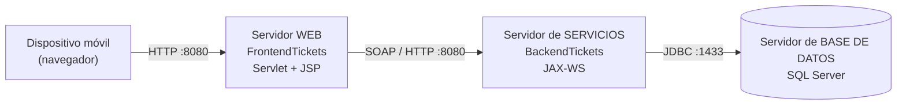
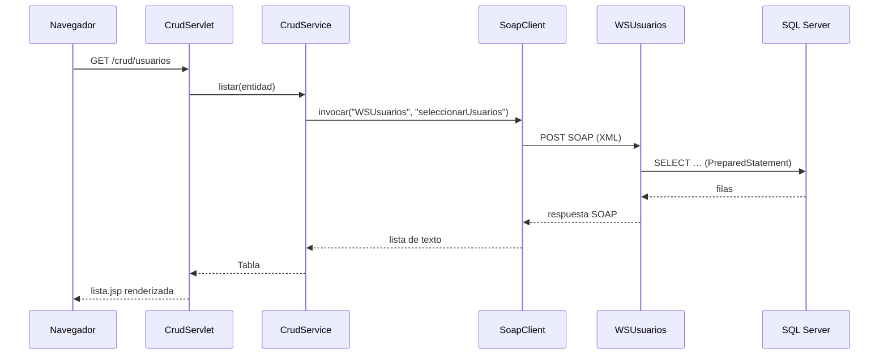
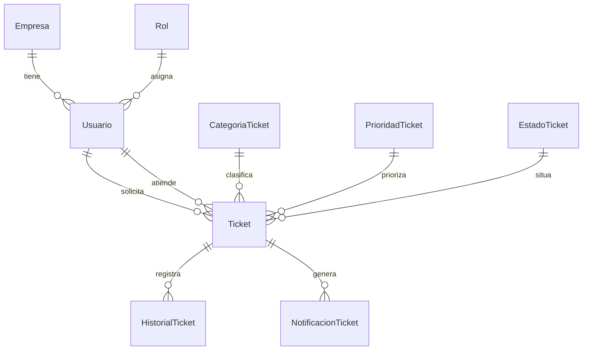
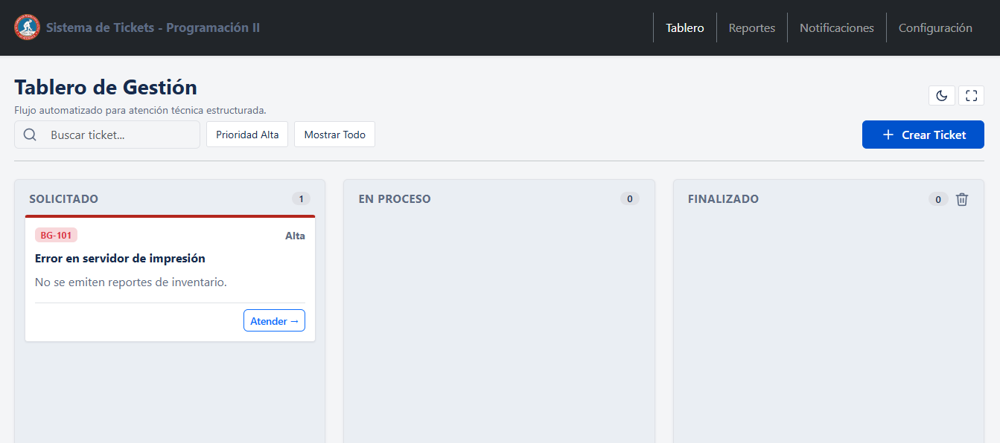
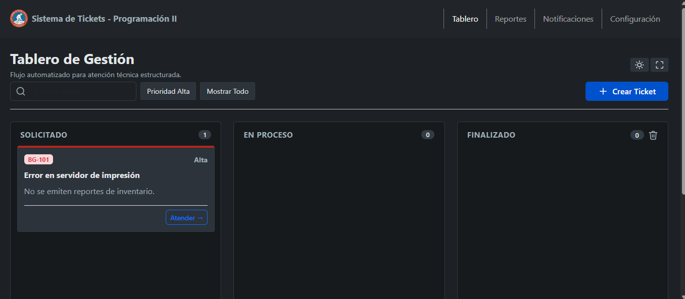
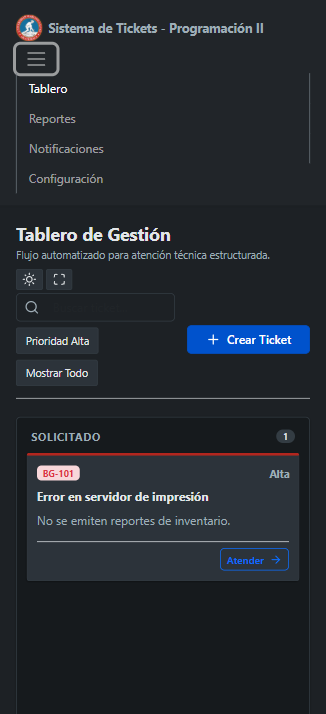
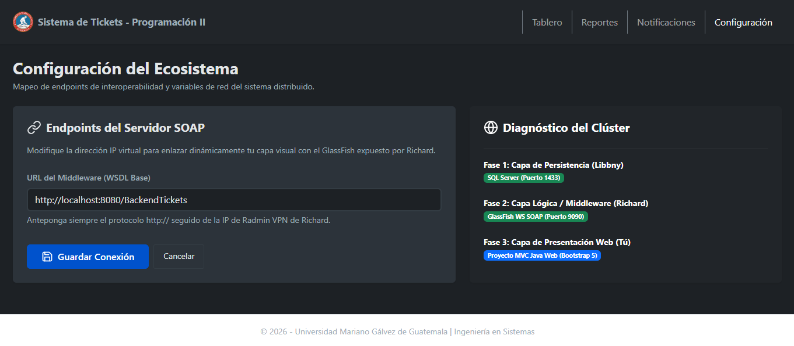

<div align="center">

# Sistema de Gestión de Tickets

**Mesa de ayuda con cola FIFO en arquitectura distribuida de 3 capas**

Proyecto Final · Programación II · Ingeniería en Sistemas · Universidad Mariano Gálvez de Guatemala


</div>

---

## Tabla de contenido

1. [Descripción](#descripción)
2. [Características](#características)
3. [Arquitectura](#arquitectura)
4. [Tecnologías](#tecnologías)
5. [Estructura del repositorio](#estructura-del-repositorio)
6. [Instalación y despliegue](#instalación-y-despliegue)
7. [Configuración](#configuración)
8. [Uso](#uso)
9. [Servicios SOAP](#servicios-soap)
10. [Base de datos](#base-de-datos)
11. [Pruebas sin infraestructura](#pruebas-sin-infraestructura)
12. [Documentación](#documentación)
13. [Estado del proyecto](#estado-del-proyecto)
14. [Equipo](#equipo)

---

## Descripción

Aplicación para registrar y atender incidencias (*help desk*) en **estricto orden de llegada** (estructura de **cola FIFO**). Cada ticket recorre un flujo de estados mutables **Solicitado → En Proceso → Finalizado**, y las reglas de negocio (generación de folio, posición en la cola, transición secuencial de estados, reclamo único por especialista) las garantiza la propia base de datos mediante *triggers*.

El sistema se despliega en **tres servidores independientes** dentro de una red local y se opera desde un **dispositivo móvil**:

| Capa | Responsabilidad | Tecnología |
|---|---|---|
| Presentación | Interfaz web responsive (MVC) | Servlet / JSP / Bootstrap 5 |
| Servicios | Lógica expuesta como servicios SOAP | JAX-WS sobre GlassFish 7 |
| Datos | Persistencia, triggers y procedimientos | SQL Server |

> La capa web **nunca** accede directamente a la base de datos: toda operación pasa por los servicios SOAP.

## Características

- **Tablero Kanban** con arrastrar y soltar (*drag and drop*), contadores por columna, búsqueda en vivo y filtro por prioridad.
- **CRUD completo** (insertar, actualizar, eliminar, listar y buscar por ID) de tickets, usuarios, empresas, roles, categorías, estados y prioridades, a partir de un único controlador genérico dirigido por metadatos.
- **Tablero FIFO conectado a los servicios**: reclamar tickets, avanzarlos de estado y consultarlos en orden de llegada.
- **Historial** de transiciones de estado y **centro de notificaciones** por especialista.
- **Configuración en caliente** de la URL del servidor de servicios con prueba de conectividad por servicio (sin recompilar).
- **Diseño responsive** mobile-first: las tablas se convierten en tarjetas en pantallas pequeñas.
- **Modo oscuro** persistente, **pantalla completa** e iconografía vectorial SVG local.
- **Funciona sin internet**: Bootstrap, estilos, scripts e íconos se sirven localmente (pensado para una red local aislada).
- Validación de formularios en servidor, escape de salida (`<c:out>`) y patrón *Post/Redirect/Get* con mensajes *flash*.

## Arquitectura



Flujo de una petición (listar usuarios):



### Patrón MVC de la aplicación web

| Capa | Paquete / carpeta | Responsabilidad |
|---|---|---|
| Modelo | `tickets.modelo` | `Entidad`, `Campo`, `Entidades` (catálogo declarativo de módulos y operaciones), `Tabla`, `Opcion` |
| Servicio | `tickets.servicio` | `CrudService`: validación, armado de parámetros y orquestación |
| Acceso a servicios | `tickets.soap` | `SoapClient`: cliente SOAP 1.1 propio con manejo de *Fault* y tiempos de espera |
| Controlador | `tickets.controlador` | `CrudServlet`, `TableroServlet`, `HistorialServlet`, `NotificacionesServlet`, `ConfigServlet`, `InicioServlet` |
| Vista | `WEB-INF/jsp` | JSP + JSTL, sin lógica de negocio |

## Tecnologías

- **Lenguaje:** Java 17
- **Plataforma:** Jakarta EE 10 (Servlet 6, JSP 3.1, JSTL 3, JAX-WS)
- **Servidor de aplicaciones:** GlassFish 7
- **Base de datos:** Microsoft SQL Server (T-SQL, triggers y procedimientos almacenados), controlador `mssql-jdbc`
- **Interfaz:** Bootstrap 5, CSS propio con variables de tema, JavaScript nativo, íconos SVG (estilo Lucide/Feather)
- **Construcción:** Maven (frontend) y NetBeans/Ant (backend)

## Estructura del repositorio

```text
sistema-tickets-java-umg/
├── backend/
│   ├── BackendTickets/          # Servicios SOAP (JAX-WS), proyecto NetBeans
├── database/
│   ├── control_tickets_db.sql   # Tablas, catálogos, triggers y procedimientos
│   ├── 01_crear_usuario_app.sql # Usuario de BD exclusivo para el backend
│   └── 02_datos_demo.sql        # Datos de demostración (opcional)
├── frontend/
│   └── FrontendTickets/         # Aplicación web (Maven, Servlet + JSP)
├── docs/                        # Guía de entrega, manuales y diccionario de datos
├── herramientas/
│   └── MockBackend.java         # Backend simulado para pruebas (no forma parte de la entrega)
└── README.md
```

## Instalación y despliegue

### Requisitos

| Componente | Versión |
|---|---|
| JDK | 17 |
| GlassFish | 7.x |
| Maven | 3.9+ |
| SQL Server | Express o superior, con TCP/IP habilitado (puerto 1433) |
| SQL Server Management Studio | Para ejecutar el script |

### 1. Base de datos

1. Abra `database/control_tickets_db.sql` en SSMS y ejecútelo. Crea `DB_ControlTickets` con sus tablas, catálogos, *triggers* y procedimientos.
2. Ejecute `database/01_crear_usuario_app.sql` (cambie antes la contraseña) y, si quiere datos de ejemplo, `database/02_datos_demo.sql`.
3. Habilite la autenticación mixta y el protocolo TCP/IP con puerto fijo `1433`.
4. Si la BD está en otra PC, abra el puerto en el firewall:
   ```bat
   netsh advfirewall firewall add rule name="SQL Server 1433" dir=in action=allow protocol=TCP localport=1433
   ```

### 2. Servidor de servicios (BackendTickets)

1. Copie `backend/BackendTickets/src/java/db.properties.example` como `db.properties` (misma carpeta) y ponga la URL, el usuario y la contraseña de la BD. Este archivo está en `.gitignore`: las credenciales **nunca** se suben al repositorio.
   ```properties
   db.url=jdbc:sqlserver://localhost:1433;databaseName=DB_ControlTickets;encrypt=true;trustServerCertificate=true;
   db.user=tickets_app
   db.password=su-contraseña
   ```
   La clase `servicios.Conexion` centraliza la conexión de los 9 servicios. También acepta las variables de entorno `TICKETS_DB_URL`, `TICKETS_DB_USER` y `TICKETS_DB_PASSWORD`.
2. Compile (*Clean and Build*) y despliegue `BackendTickets.war` en GlassFish.
3. Verifique el contrato en `http://IP-SERVICIOS:8080/BackendTickets/WSTickets?wsdl`.

### 3. Aplicación web (FrontendTickets)

```bash
cd frontend/FrontendTickets
mvn clean package
asadmin deploy --force target/FrontendTickets.war
```

Para Tomcat 10.1 use el perfil que empaqueta JSTL: `mvn clean package -Ptomcat`.

La aplicación queda disponible en `http://IP-WEB:8080/FrontendTickets/`.

### Todo en una sola máquina

Backend y frontend pueden desplegarse en el **mismo GlassFish** (puerto 8080) junto a SQL Server local:

| Componente | URL |
|---|---|
| Servicios SOAP | `http://localhost:8080/BackendTickets/WSTickets?wsdl` |
| Aplicación web | `http://localhost:8080/FrontendTickets/` |

En este caso no hace falta cambiar ninguna IP: los valores por defecto ya apuntan a `localhost`.

## Configuración

La URL base de los servicios SOAP se resuelve en este orden de prioridad:

| # | Mecanismo | Ejemplo |
|---|---|---|
| 1 | Propiedad de JVM | `-Dsoap.base.url=http://192.168.1.11:8080/BackendTickets` |
| 2 | Variable de entorno | `TICKETS_SOAP_URL=http://192.168.1.11:8080/BackendTickets` |
| 3 | Archivo `config.properties` | `soap.base.url=http://192.168.1.11:8080/BackendTickets` |
| 4 | Valor por defecto | `http://localhost:8080/BackendTickets` |

También puede cambiarse en caliente desde **Configuración** en la propia aplicación y probar la conexión con cada uno de los servicios.

**Plan de red de ejemplo**

| Equipo | Rol | IP |
|---|---|---|
| PC 1 | Base de datos (SQL Server) | `192.168.1.10` |
| PC 2 | Servicios (BackendTickets) | `192.168.1.11` |
| PC 3 | Web (FrontendTickets) | `192.168.1.12` |
| Móvil | Cliente de la presentación | `192.168.1.20` |

## Uso

| Ruta | Descripción |
|---|---|
| `/inicio` | Tablero Kanban con arrastrar y soltar, búsqueda y filtros |
| `/tablero` | Tablero FIFO conectado a los servicios (reclamar y avanzar) |
| `/crud/{modulo}` | Listado, alta, edición, baja y búsqueda por ID. Módulos: `tickets`, `usuarios`, `empresas`, `roles`, `categorias`, `estados`, `prioridades` |
| `/historial` | Trazabilidad de cambios de estado por ticket |
| `/notificaciones` | Alertas del sistema y pendientes por especialista |
| `/config` | URL de los servicios SOAP y prueba de conectividad |

## Servicios SOAP

Un `@WebService` por área, publicado en `/{contexto}/{WSNombre}` con el espacio de nombres `http://servicios/`.

| Servicio | Operaciones principales |
|---|---|
| `WSTickets` | insertar, reclamar, cambiar estado, eliminar (lógico), listar |
| `WSUsuarios` | insertar, actualizar, desactivar, listar, buscar por ID |
| `WSEmpresas` | insertar, actualizar, desactivar, listar, buscar por ID |
| `WSRoles` | insertar, actualizar, eliminar, listar, buscar por ID |
| `WSCategorias` · `WSEstados` · `WSPrioridades` | insertar, actualizar, eliminar, listar |
| `WSHistorial` | historial por ticket |
| `WSNotificaciones` | pendientes por especialista, marcar como leída |

## Base de datos

Nueve tablas, tres *triggers* y doce procedimientos almacenados.



| Trigger | Función |
|---|---|
| `TR_Ticket_Insertar` | Genera el folio por categoría, fija la posición FIFO y registra el estado inicial |
| `TR_Ticket_ValidarEstado` | Permite avanzar solo un estado a la vez y registra el cambio |
| `TR_Ticket_Reclamo` | Impide el doble reclamo y genera la notificación |

El detalle de columnas, tipos y restricciones está en [`docs/DICCIONARIO_DB.md`](docs/DICCIONARIO_DB.md).

## Pruebas sin infraestructura

`herramientas/MockBackend.java` simula los nueve servicios SOAP con datos en memoria, sin necesidad de SQL Server ni GlassFish:

```bash
java herramientas/MockBackend.java            # escucha en el puerto 8081
```

Luego, en **Configuración**, apunte a `http://localhost:8081/BackendTickets`. Es útil para desarrollar la interfaz y como plan de contingencia durante una demostración.

## Documentación

| Documento | Contenido |
|---|---|
| [`docs/MANUAL_TECNICO.md`](docs/MANUAL_TECNICO.md) | Arquitectura, MVC, SOAP y estructura FIFO |
| [`docs/MANUAL_CONFIGURACION.md`](docs/MANUAL_CONFIGURACION.md) | Configuración de servidores y red |
| [`docs/MANUAL_USUARIO.md`](docs/MANUAL_USUARIO.md) | Uso de cada pantalla |
| [`docs/DICCIONARIO_DB.md`](docs/DICCIONARIO_DB.md) | Diccionario de datos |

## Capturas

| Tablero Kanban | Modo oscuro |
|---|---|
|  |  |

| Vista móvil | Configuración |
|---|---|
|  |  |

## Estado del proyecto

- [x] Modelo de datos, *triggers* y procedimientos almacenados
- [x] Servicios SOAP para las nueve tablas
- [x] Aplicación web MVC con CRUD genérico, cliente SOAP y validaciones
- [x] Interfaz responsive con Bootstrap local, modo oscuro e íconos SVG
- [x] Tablero Kanban con arrastrar y soltar
- [x] Conectar el tablero Kanban de `/inicio`, el historial y las notificaciones a los servicios SOAP reales
- [x] Reportes formales del historial de cada ticket: PDF institucional (logo, indicadores, gráfico de tiempo por estado, tabla paginada) y libro de Excel (.xlsx) con resumen y filtros


## Equipo

| Integrante | Carnet: |
|---|---|
| Darío Alfredo Rabe Godoy | 5190-25-23683 |
| Richard Esteev Pernillo Macario | 5190-25-21234 |
| Cristian Daniel Emiliano Cano Estrada | 5190-25-24608 |
| Libbny Dayana Medrano Arévalo | 5190-25-24096 |
| Holcen Eduardo Ajín González | 5190-25-24834 |

**Curso:** Programación II · **Catedrático:** Sergio Guillermo Gómez Mendóza · **Universidad Mariano Gálvez de Guatemala**, Ingeniería en Sistemas · 2026

---

<div align="center">
<sub>Proyecto académico desarrollado con fines educativos.</sub>
</div>
